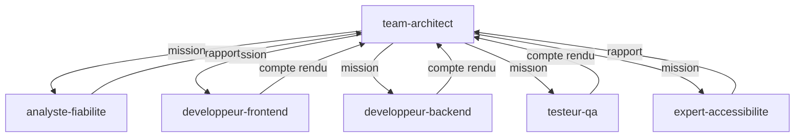

# Architecture de l'équipe mlm

> Généré par team-architect le 2026-11-19. Source : demande utilisateur (optimiser, analyser erreurs d'accès, détecter au maximum et vite, charte DSFR).

## 1. Projet et objectifs
mairie-link-monitor (v0.16, Python, ~4300 lignes, `src/`, `tests/`) détecte les sites de mairies contenant un lien vers vosquestions.ecologie-territoires.gouv.fr. Objectifs : (a) plus rapide et plus efficient ; (b) analyser les erreurs potentielles et d'accès aux sites ; (c) détecter un maximum de liens ; (d) interface (`webapp.py`, `report.py`) conforme au DSFR avec les logos du site vosquestions. Exclu : changer la nature de l'outil.

## 2. Justification de l'architecture
5 postes, choix utilisateur (équipe étendue). Deux contrôleurs en lecture seule (fiabilité, accessibilité) et un testeur indépendant ; deux producteurs (backend, frontend) travaillant en parallèle sur des fichiers disjoints. Écartés : une session seule ; Agent Teams.

## 3. Organisation
team-architect (session principale, seul détenteur du contexte) → sous-agents créés depuis AGENTS.md. Pas d'imbrication, pas d'échange entre agents, aucun contact agent ↔ utilisateur. Ce document ne concerne que ce projet.

## 4. Agents et responsabilités
| Agent | Métier | Périmètre de fichiers et décisions | Hors périmètre | Pourquoi il existe |
|---|---|---|---|---|
| developpeur-backend | Backend | `src/crawl_links.py`, `platforms.py`, `tuning.py`, `discover.py`, `verify_urls.py`, `metrics.py` | `webapp.py`, `report.py`, `tests/` | Gros fichiers, parallèle au front |
| analyste-fiabilite | Fiabilité | Lecture de tout `src/` ; aucun fichier modifié | Toute écriture | Contrôle indépendant |
| developpeur-frontend | Frontend | `src/webapp.py`, `src/report.py`, ressources DSFR (`src/static/`) | Logique de crawl, tests | Zone disjointe du backend |
| expert-accessibilite | Accessibilité | Lecture du rendu HTML ; aucun fichier modifié | Toute écriture | Contrôle indépendant |
| testeur-qa | QA | `tests/` | Code de production | Contrôle indépendant |

## 5. Répartition des compétences
| Agent | Compétences | Modèle (justification) | Outils | MCP |
|---|---|---|---|---|
| developpeur-backend | concurrence, réseau, perf | haiku (missions courtes) | Read, Grep, Glob, Edit, Write, Bash | aucun |
| analyste-fiabilite | audit, erreurs réseau | haiku | Read, Grep, Glob, Bash | aucun |
| developpeur-frontend | HTML/CSS, DSFR | haiku | Read, Grep, Glob, Edit, Write, Bash | aucun |
| expert-accessibilite | RGAA, contrastes | haiku | Read, Grep, Glob, Bash | aucun |
| testeur-qa | tests unittest | haiku | Read, Grep, Glob, Edit, Write, Bash | aucun |

## 6. Dépendances et interactions

Lots : audit (aucune dépendance) → correctifs backend (dépend de l'audit) → tests (dépend des correctifs). Refonte DSFR (indépendante) → revue accessibilité (dépend de la refonte).

## 7. Protocoles de communication
Mission autoportante de team-architect → compte rendu borné (< 300 mots). Aucune communication directe entre agents.

## 8. Contexte et mémoire de travail
Agents : leur fiche + la mission seulement. team-architect : ce document + jalons dans `docs/equipe-mlm/jalons/`. Conventions à transmettre : Python 3 stdlib + dépendances du README, tests `python3 -m unittest discover -s tests`, politesse du crawler (robots.txt, délais par site) inchangée, textes en français, DSFR via paquet npm `@gouvfr/dsfr` (hors ligne, pas de CDN), logo vosquestions à récupérer si disponible.

## 9. Stratégie de délégation
Une mission = un livrable, quelques fichiers, critères vérifiables. team-architect fait lui-même la récupération DSFR/logos, l'intégration, les commits.

## 10. Tâches parallèles
V1 : analyste-fiabilite ‖ developpeur-frontend. V2 : developpeur-backend (correctifs de l'audit). V3 : testeur-qa ‖ expert-accessibilite. V4 : synthèse. Jamais deux agents sur les mêmes fichiers dans une vague.

## 11. Erreurs et conflits
BLOQUÉ/ÉCHEC : une relance avec contexte précisé, puis reprise par team-architect. Priorité : sécurité > exactitude de détection > politesse du crawler > vitesse > esthétique.

## 12. Validation et contrôle qualité
Suite de tests verte ; aucun test supprimé ou désactivé ; rappel de détection non dégradé ; rendu HTML relu par expert-accessibilite.

## 13. Critères de réussite
Débit mesuré en hausse sans baisse de rappel ; liste d'erreurs d'accès classées avec correctifs appliqués ; interface DSFR (en-tête, bloc-marque, polices Marianne, composants) ; tests verts.

## 14. Contraintes d'exécution
Politesse conservée (robots.txt, délais par site). Hôtes réseau autorisés : DSFR, vosquestions, github. Pas de push hors branche `claude/keen-rubin-fne43o`.

## 15. Règles de sécurité
Pas de secret en clair ; pas de crawl massif en test (fixtures et serveurs locaux) ; pas d'action destructive ; agents sans accès à AskUserQuestion/Agent/Skill.

## 16. Optimisation des tokens
Fiches courtes, missions ciblées avec chemins, comptes rendus bornés, haiku partout, vagues parallèles.

## 17. Intégration dans Claude Code
Agents créés depuis AGENTS.md ; pilotage et reprise via `/team-architect` ; voir LANCEMENT.md.
